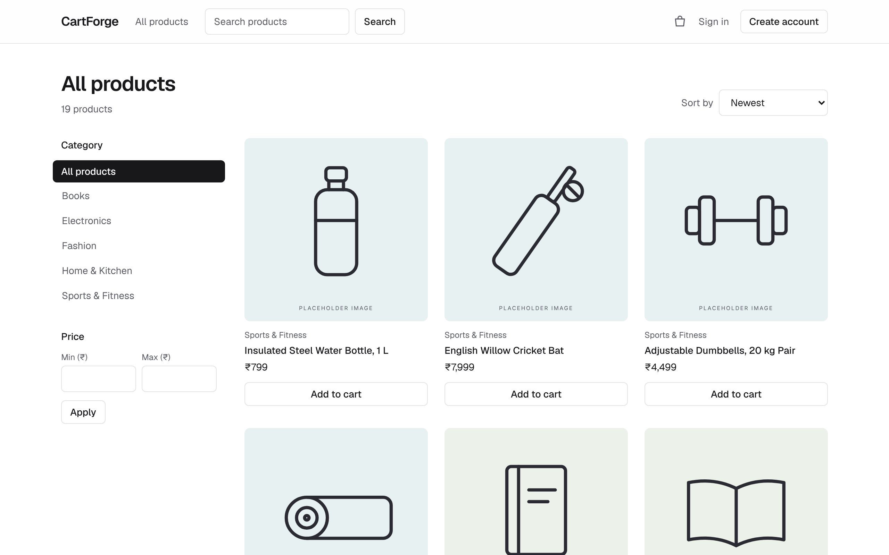
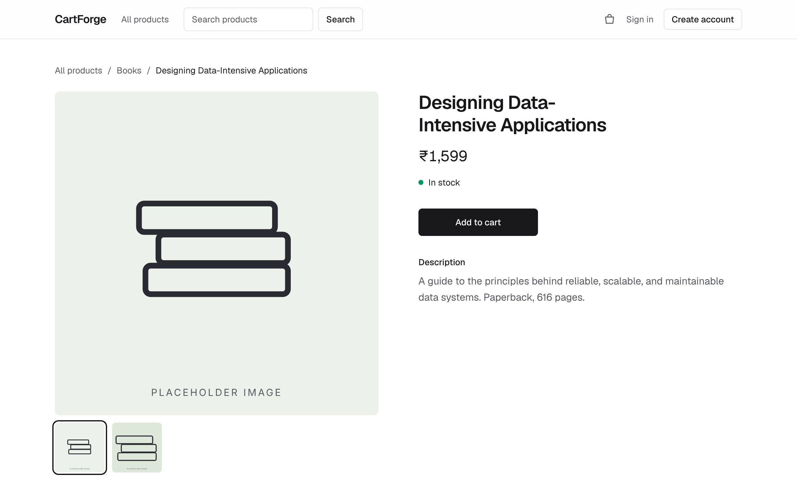
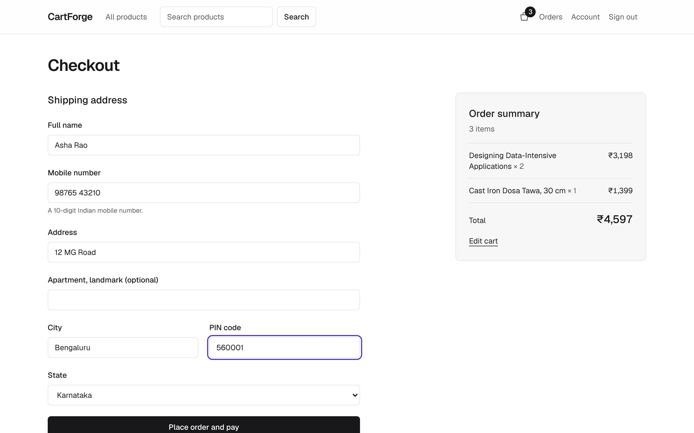
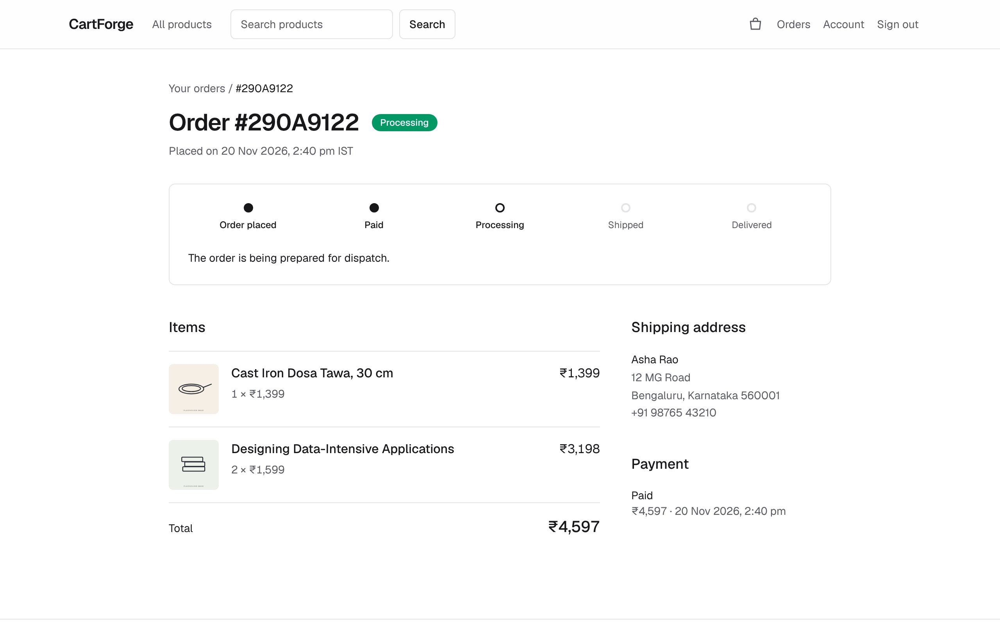
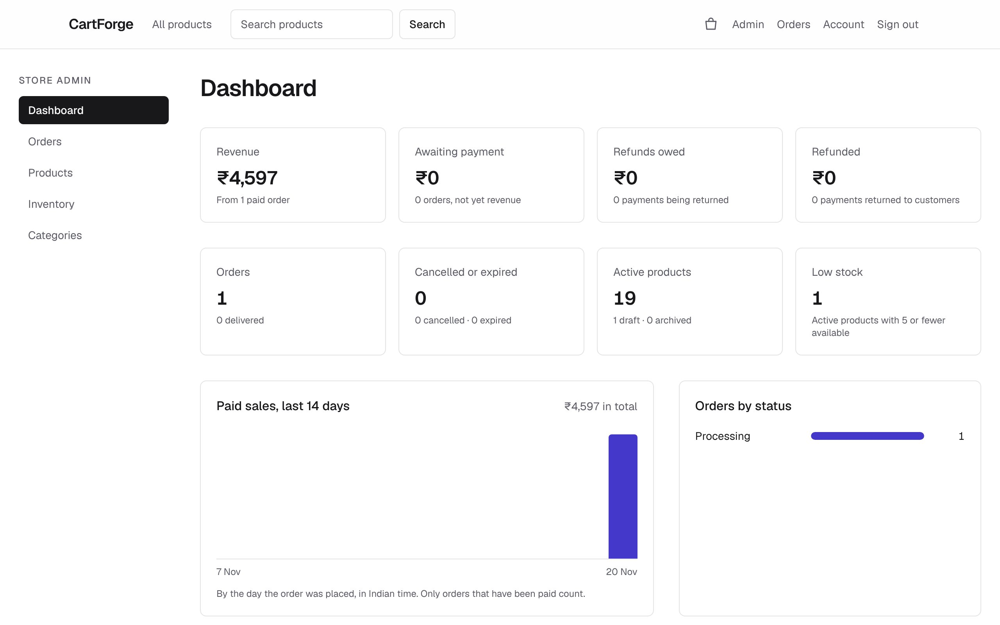
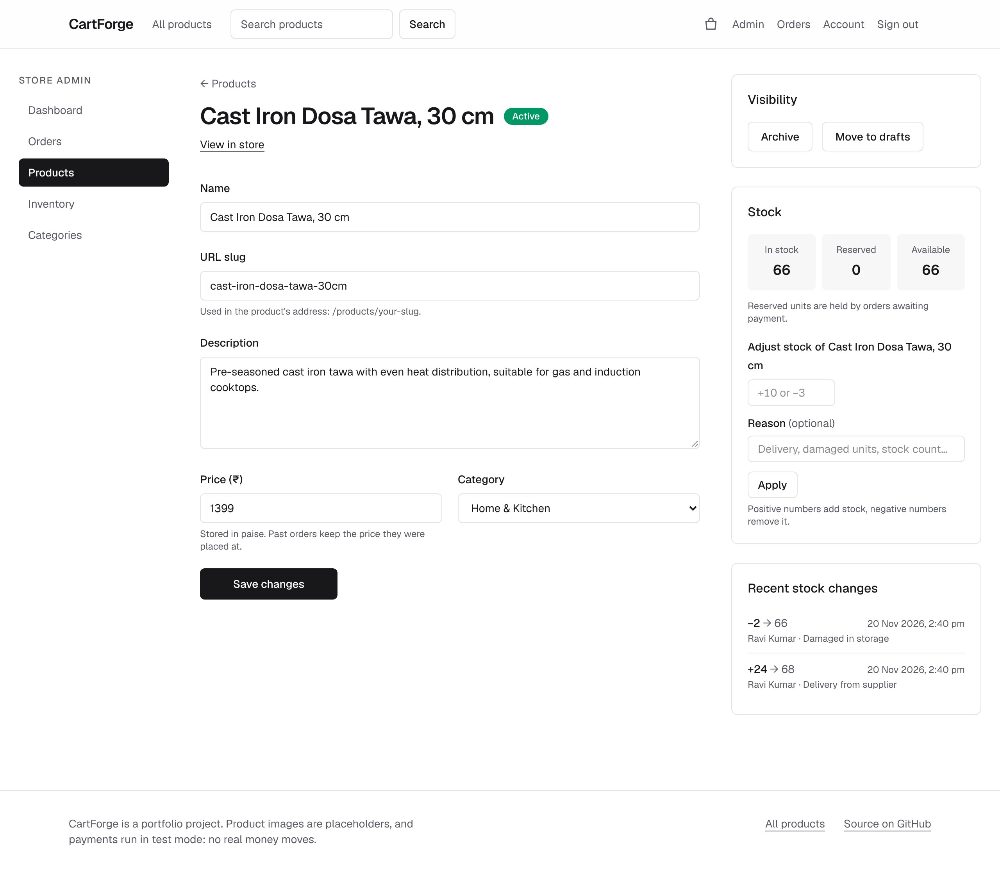
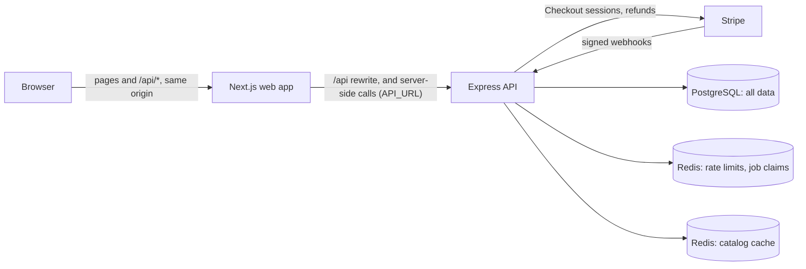
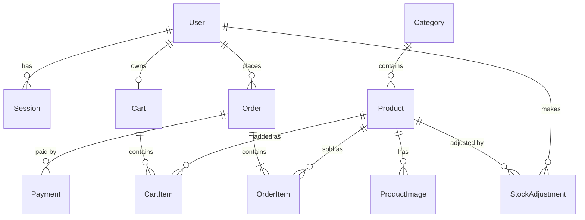
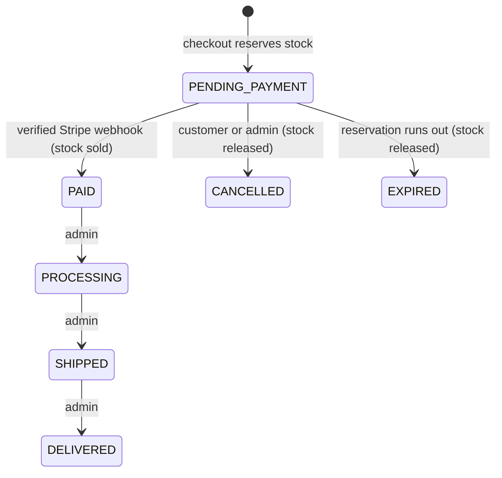

# CartForge

A full-stack e-commerce application built as a portfolio project:

- a Next.js storefront and admin area;
- an Express API organised as a modular monolith;
- PostgreSQL through Prisma, and Redis for rate limiting and catalog caching;
- Stripe Checkout in test mode.

Prices are in Indian rupees and stored as integer paise.

**Status:**

- **Development:** all ten milestones in [docs/roadmap.md](docs/roadmap.md) are done.
- **Testing:** 560 unit and integration tests and 21 Playwright end-to-end tests. All pass locally and in GitHub Actions: both CI jobs, `verify` and `e2e`, passed on the commit merged in [theritwik/CartForge#11](https://github.com/theritwik/CartForge/pull/11).
- **Release verification, still pending:**
  - **Stripe:** payments have been tested with a mocked Stripe API and a labelled local simulator, but **not yet against real Stripe test mode** ([why, and how to do it](docs/stripe-test-mode.md)).
  - **Deployment:** none. The application runs from production containers locally, and [docs/deployment.md](docs/deployment.md) compares hosting options.

| Storefront                                       | Product                                                  | Checkout                                                  |
| ------------------------------------------------ | -------------------------------------------------------- | --------------------------------------------------------- |
|  |           |                 |
| **Order tracking**                               | **Admin dashboard**                                      | **Stock history**                                         |
|       |  |  |

More: [cart](docs/screenshots/cart.jpg), [payment simulator](docs/screenshots/payment-simulator.jpg), [admin order](docs/screenshots/admin-order.jpg), [phone layout](docs/screenshots/mobile-search.jpg). Product images are labelled placeholder drawings.

## Features

- **Catalog:**
  - search across names and descriptions, filters by category and price, and sorting with pagination;
  - product pages with an image gallery and live stock;
  - only published products are shown.
- **Accounts:**
  - registration, sign-in, sign-out, sign-out of every device, and password change;
  - Argon2id password hashes;
  - opaque sessions in an `HttpOnly` cookie, with idle and absolute expiry.
- **Cart:**
  - stored per account, so it follows the customer across devices;
  - totals calculated on the server from current prices;
  - items that become unavailable are kept and flagged, not deleted.
- **Checkout:**
  - idempotent order creation that rechecks price, status and stock;
  - reserves the stock for 30 minutes and releases it on expiry or cancellation.
- **Payments:**
  - Stripe Checkout in test mode; an order is marked paid only by a signature-verified webhook;
  - each payment is reconciled on amount, currency and order;
  - late or duplicate payments are refunded automatically;
  - failed attempts can be retried.
- **Administration:**
  - a dashboard of sales, orders and stock;
  - product and category management;
  - stock adjustments with a history of who changed what and why;
  - order fulfilment limited to an explicit status policy, in which administrators can never mark an order paid.
- **Hardening:**
  - CSRF origin checks;
  - rate limits on sign-in, registration, every state-changing request and admin writes;
  - security headers;
  - input validation of every request and environment variable;
  - a recorded [security review](docs/security-review.md).
- **Performance:** a Redis cache-aside layer for the catalog, which never caches price, status or stock, and trigram and sort indexes, all measured on a 50,000-product dataset ([docs/performance.md](docs/performance.md)).

## Stack

| Area     | Technology                                                              |
| -------- | ----------------------------------------------------------------------- |
| Web      | Next.js 16 (App Router), React 19, Tailwind CSS 4                       |
| API      | Node.js 24, Express 5, Zod 4, Pino                                      |
| Data     | PostgreSQL 17 with Prisma 7, Redis 8 (two instances)                    |
| Payments | Stripe Checkout, test mode only                                         |
| Testing  | Vitest, Supertest, Playwright                                           |
| Tooling  | TypeScript 6, pnpm workspaces, ESLint, Prettier, Docker, GitHub Actions |

## Architecture



- **One origin:** the browser only talks to the web app. Its `/api` proxy forwards requests to the API, so session cookies stay same-origin and no CORS is needed.
- **The API** is one process with feature modules: `auth`, `users`, `products`, `cart`, `inventory`, `orders`, `payments` and `admin`. Controllers parse input with Zod and call one service function, and services hold the business rules. Several instances can run side by side: sessions live in PostgreSQL, and background jobs are coordinated through Redis.
- **PostgreSQL is the source of truth** for stock, prices, orders, payments, sessions and roles. Redis holds rate-limit counters and a disposable cache, and the API keeps working without either.

Design decisions are in [docs/architecture.md](docs/architecture.md), and the trade-offs are discussed in [docs/interview-notes.md](docs/interview-notes.md).

## Data model



Some rules are enforced by the database itself, so application bugs can't break them:

- CHECK constraints keep prices and stock non-negative, and keep reserved stock at or below physical stock.
- Triggers make order items, a snapshot of name and price at purchase, and stock adjustments immutable.
- A partial unique index allows only one pending payment per order.

The full schema is in [docs/database.md](docs/database.md).

## Order and payment lifecycle



- **Checkout:**
  - needs an `Idempotency-Key`; repeating the request returns the same order;
  - the client sends the total it showed the customer, and the server compares it, but always charges its own figure.
- **Paying:**
  - opens a Stripe Checkout session with no database transaction held open across the Stripe call;
  - the session is created with an idempotency key derived from the payment id.
- **Marking paid:** happens only in the webhook handler, after the signature check and reconciliation, in one transaction that also records the event id. Redelivered events change nothing.
- **When money can't be applied** (the order expired, was cancelled or was already paid, or the amounts don't match): the payment becomes `REFUND_PENDING` and is refunded. If Stripe is unreachable, a background job retries every minute.

## Inventory concurrency

Products hold `stock_quantity` and `reserved_quantity`; available stock is the difference.

- **Reserving, releasing and selling** stock all run inside the caller's transaction, as conditional updates in product-id order. That order prevents deadlocks, and the condition prevents overselling, for example `reserved_quantity + n <= stock_quantity`. Two customers buying the last unit at once: one succeeds, the other is told it's gone.
- **Order status changes** are conditional on the current status (`UPDATE ... WHERE status = 'PENDING_PAYMENT'`). Expiry, cancellation and payment can race, but exactly one wins, and stock is released or sold exactly once.
- **Administrator adjustments** are relative and can never take stock below what unpaid orders hold. Each one is recorded in the same transaction.
- **Cart writes** lock the cart row, so a customer's concurrent requests apply one after another.

Concurrency tests cover each of these: the last unit, multi-product rollback, racing expiry and payment, and concurrent adjustments during checkout.

## Catalog caching

The catalog is cached cache-aside in its own Redis instance:

- **Entries** hold the expensive part (which products match, in what order, the total count, and display fields) for 2 to 5 minutes.
- **Never cached:** price, status and stock. They are read from PostgreSQL on every request by primary key and merged in, so a cached page can never show a stale price or sell a withdrawn product.
- **Invalidation:** every catalog write increments a generation number that is part of every key, so one Redis command invalidates the cache on all instances.
- **Failures:** unreadable entries are discarded. If Redis is unreachable, the catalog is served from PostgreSQL with no errors.
- **Isolation:** the cache instance can evict entries under memory pressure without touching rate-limit counters, which live on a separate instance that never evicts.

## Performance

Measured with autocannon and a sequential probe on a deterministic 50,000-product dataset. The load generator, API, PostgreSQL and Redis all ran on one 4-vCPU machine, so the numbers compare configurations with each other and say nothing about production capacity.

| Requests per second (10 connections) | Before | Indexes only | Cache hit | Cache unavailable |
| ------------------------------------ | -----: | -----------: | --------: | ----------------: |
| Search, two terms                    |     38 |          282 |     1,895 |               281 |
| Price sort, whole catalog            |    148 |          560 |     2,138 |               567 |
| Default listing page                 |    376 |          532 |     1,962 |               559 |
| Product detail                       |  1,647 |        1,820 |     2,551 |             1,698 |

- **Indexes gave the largest gain:** trigram indexes made search 7 times faster without any cache.
- **Product detail barely benefits from caching**, because it was already a single index lookup.
- **A cache miss costs 0.6 to 1.3 ms more than no cache.**
- **The 14-day sales trend on the admin dashboard** went from 131.6 ms to 7.5 ms on 200,000 orders, after an index and a rewritten date filter.

Method, all five configurations and query plans: [docs/performance.md](docs/performance.md).

## Testing

| Suite                                | What it covers                                                                                                                                                                                                                                                                                    | Count |
| ------------------------------------ | ------------------------------------------------------------------------------------------------------------------------------------------------------------------------------------------------------------------------------------------------------------------------------------------------- | ----: |
| API integration (Vitest + Supertest) | Every endpoint against a real PostgreSQL test database: business rules, authorization (anonymous, customer, admin, other customers), validation, rate limits, concurrency, payments with mocked Stripe and signed webhooks, cache behaviour and Redis outages                                     |   444 |
| Database (Vitest)                    | Constraints, triggers, relationships, and the seed                                                                                                                                                                                                                                                |    32 |
| Web unit (Vitest)                    | Form validation, URL filter parsing, formatting, view logic, security headers                                                                                                                                                                                                                     |    84 |
| End-to-end (Playwright)              | Production builds in Chromium: registration, sign-in, session expiry, search and filters, cart persistence across devices, checkout validation, simulated payment success, failure and retry, cancellation, order history, admin access, product editing, stock adjustments, and order fulfilment |    21 |

Tests never touch development data:

- **API and database tests** use `TEST_DATABASE_URL`, whose name must end in `_test`.
- **The browser suite** uses its own `cartforge_e2e_test` database, Redis database indexes 2 and 3, and ports 4200 and 3200, so it can run beside `pnpm dev`. Payments always go through the labelled development simulator.

CI runs formatting, lint, type checks, a migration drift check, the unit and integration tests and the build, then the browser suite in a second job.

```bash
pnpm test
```

```bash
pnpm e2e
```

`pnpm e2e` builds the API and web app, prepares its database, and runs the suite.

## Local development

Prerequisites: Node.js 24 (`.nvmrc`), pnpm 10, and Docker with Compose.

```bash
cp .env.example .env
```

```bash
cp apps/web/.env.example apps/web/.env.local
```

```bash
pnpm install
```

```bash
pnpm services:up
```

```bash
pnpm db:migrate
```

```bash
pnpm db:seed
```

```bash
pnpm dev
```

The web app runs at http://localhost:3000 and the API at http://localhost:4000.

- **Services:** `pnpm services:up` starts PostgreSQL, the rate-limit Redis and the cache Redis.
- **Seed:** `pnpm db:seed` loads 5 categories and 20 products, and can be run again safely.
- **Administrator:** create one with `pnpm admin:create`. It prompts for the password, which is never passed as an argument or environment variable.
- **Payments:** without Stripe keys, "Place order and pay" opens a local page labelled **Development simulator · not Stripe**. It sends signed events shaped like Stripe's through the real webhook handler. No money moves and no card details are collected, and the simulator doesn't exist in production.

| Command                                  | Purpose                                           |
| ---------------------------------------- | ------------------------------------------------- |
| `pnpm dev`                               | API and web app with reload                       |
| `pnpm build`                             | Build every package                               |
| `pnpm lint`, `pnpm typecheck`            | ESLint and TypeScript                             |
| `pnpm format`, `pnpm format:check`       | Prettier                                          |
| `pnpm test`, `pnpm e2e`                  | Unit and integration tests; browser tests         |
| `pnpm db:migrate`, `pnpm db:seed`        | Create and apply a migration; load the catalog    |
| `pnpm admin:create`                      | Create or promote an administrator                |
| `pnpm services:up`, `pnpm services:down` | Start or stop PostgreSQL and both Redis instances |

Configuration lives in `.env` (Compose, the API, the Prisma CLI and tests) and `apps/web/.env.local` (`API_URL`). Both are validated at startup. The endpoint reference is in [docs/api.md](docs/api.md).

## Deployment

The API image has a `runtime` target and a `migrate` target for applying migrations, and the web app has its own image. The whole stack runs from them:

```bash
docker compose --profile full up --build
```

That serves the store on http://localhost:8080 in production mode. Production requires Stripe test-mode keys in `.env`, because there is no simulator in production.

[docs/deployment.md](docs/deployment.md) covers:

- the environment variables and secure production settings;
- health and readiness checks;
- the migration and rollback procedure, and backups;
- Redis configuration;
- three hosting options with what each requires, and a deployment checklist.

Nothing has been deployed.

## Known limitations

- **Real Stripe test mode not verified.** Everything payment-related is tested against mocks and the simulator; [docs/stripe-test-mode.md](docs/stripe-test-mode.md) is the procedure.
- **Missing features:** no password reset, no email verification, and no email at all. Paid orders cannot be refunded from the admin area, and products created in the admin have no images (no upload).
- **No script Content Security Policy:** the web app restricts framing, form targets and plugins, but not scripts.
- **Search:** terms shorter than three characters can't use the trigram index, and deep pages use `OFFSET`.
- **Cache stampede:** concurrent cache misses for one page each query the database.
- **Image size:** the images are large (746 MB API, 935 MB web uncompressed).
- **Not yet built:** an admin activity log beyond stock changes, and a delivery pipeline.

The backlog in [docs/roadmap.md](docs/roadmap.md) tracks these.

## Documentation

| Document                                        | Contents                                                                |
| ----------------------------------------------- | ----------------------------------------------------------------------- |
| [architecture.md](docs/architecture.md)         | Design decisions, module boundaries, flows, consistency and concurrency |
| [database.md](docs/database.md)                 | Schema, constraints, migrations, test databases                         |
| [api.md](docs/api.md)                           | Endpoints, parameters, and error codes                                  |
| [performance.md](docs/performance.md)           | Benchmark method and results, caching design, indexes                   |
| [security-review.md](docs/security-review.md)   | Security and reliability review, findings and fixes                     |
| [deployment.md](docs/deployment.md)             | Production configuration, operations, hosting options, checklist        |
| [stripe-test-mode.md](docs/stripe-test-mode.md) | How to verify payments against Stripe's test environment                |
| [interview-notes.md](docs/interview-notes.md)   | Engineering decisions and likely interview questions                    |
| [roadmap.md](docs/roadmap.md)                   | Milestones, status, and backlog                                         |
