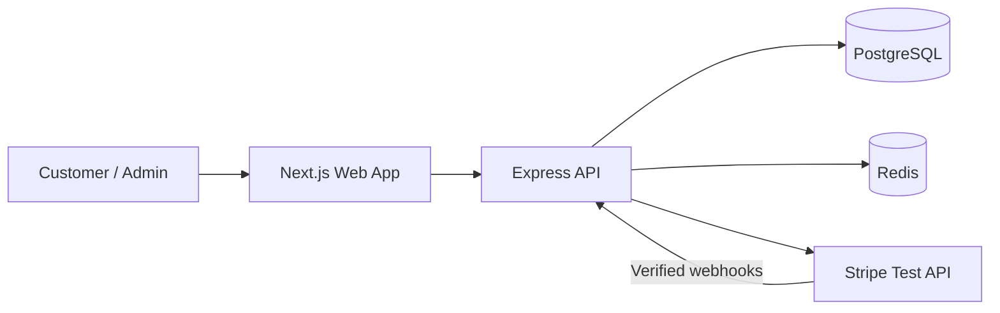

CartForge
A full-stack e-commerce platform focused on reliable order processing, secure checkout, and maintainable backend engineering.

CartForge is a portfolio project built to explore the engineering challenges behind an online store: keeping inventory accurate under concurrent purchases, handling payment events safely, and delivering a responsive shopping experience.
Status: In development. Features below are planned unless explicitly marked complete. Demo links, screenshots, and performance results will be added after they have been verified.

What we're building
- Storefront: Product browsing, search, filters, sorting, and pagination.
- Accounts: Registration, sign-in, secure sessions, and role-based access.
- Shopping cart: Persistent carts with server-side price and stock validation.
- Orders: Transactional order creation, order history, and lifecycle tracking.
- Inventory: Concurrency-safe stock updates to prevent overselling.
- Checkout: Stripe test-mode integration with verified, idempotent webhooks.
- Admin dashboard: Product, inventory, and order management.
- Performance: Targeted Redis caching, query optimization, and measured benchmarks.
- Quality: Automated tests, CI checks, structured logging, and Docker-based development.
Tech stack
Layer	Technologies
Frontend	Next.js (App Router), React, TypeScript, Tailwind CSS
Backend	Node.js, Express, TypeScript
Database	PostgreSQL, Prisma ORM
Cache	Redis
Payments	Stripe (test mode only)
Testing	Vitest, Supertest, Playwright
Tooling	pnpm workspaces, Docker Compose, GitHub Actions

Architecture

The application uses a modular monolith, not microservices. HTTP routes and controllers remain thin; business rules live in feature services; Prisma manages persistence. Redis is introduced only where caching or coordination is justified.
Repository layout
cartforge/
├── apps/
│   ├── web/                 # Next.js storefront and admin UI
│   └── api/
│       ├── src/
│       │   ├── config/
│       │   ├── modules/      # auth, products, cart, orders, payments...
│       │   ├── middleware/
│       │   ├── lib/
│       │   ├── app.ts
│       │   └── server.ts
│       └── tests/
├── packages/
│   └── db/                  # Prisma schema, migrations, seeds
├── docs/                    # Architecture and API notes
├── .github/workflows/       # CI
├── docker-compose.yml
├── pnpm-workspace.yaml
└── README.md
Folders will be created as their corresponding features are implemented. Additional shared packages will only be introduced if multiple apps genuinely need them.
Engineering priorities
Order and inventory consistency
Stock must be validated and changed atomically. Concurrent checkouts should never sell the same last unit twice. The order lifecycle will explicitly account for failed or abandoned payments.

Payment reliability
The frontend redirect is not proof of payment. Checkout state will be updated from verified Stripe webhooks, with duplicate and out-of-order event handling where needed. No real card details will be stored by CartForge.

Security by default
Validate inputs at API boundaries, enforce authorization server-side, protect sessions, and keep secrets out of source control. Product prices and totals are always computed by the server.

Measured performance
Cache publicly shareable catalog responses where useful; invalidate them on writes. Record benchmark setup and actual results before claiming performance improvements.
Development roadmap
- [ ] Scaffold monorepo, frontend, API, and local services
- [ ] Design database schema and seed sample data
- [ ] Implement authentication and role-based authorization
- [ ] Build product catalog, search, filters, and pagination
- [ ] Implement persistent shopping cart
- [ ] Add transactional orders and concurrency-safe inventory
- [ ] Integrate Stripe test checkout and verified webhooks
- [ ] Build admin product, stock, and order management
- [ ] Introduce Redis caching and benchmark key endpoints
- [ ] Add unit, integration, and end-to-end tests
- [ ] Configure CI, deploy, and document the running system
Getting started
The repository is currently in the planning stage. Verified setup and run commands will be added after the initial scaffold is implemented. The intended local environment requires Node.js, pnpm, and Docker.

Once setup is complete, this section will document environment configuration, database migrations, seed data, development scripts, and test commands.
Testing approach
- Unit tests: Pricing, validation, order state transitions, and inventory rules.
- Integration tests: API endpoints, authentication, database transactions, and payment webhooks.
- End-to-end tests: Browsing, cart, test checkout, order history, and admin workflows.
- Concurrency tests: Simultaneous purchases of limited stock.
Documentation
Architecture diagrams, API contracts, key technical decisions, and deployment instructions will live in [`docs/`](docs/) as they are implemented.
CartForge is an educational portfolio project. Payments will use test mode; production deployment, security, and performance claims will be documented only when verified.
