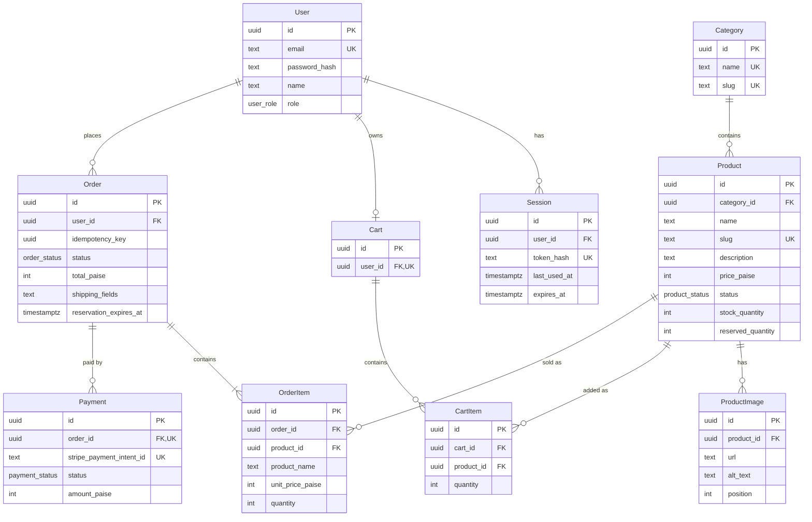

# CartForge Database

PostgreSQL 17, managed with Prisma. The schema is defined in `packages/db/prisma/schema.prisma` and applied through migrations in `packages/db/prisma/migrations`.

The tables were created in Milestone 2 and extended by later migrations (see the migration history below).

## Relationships

| Relationship           | Type        | On delete of the parent                                    |
| ---------------------- | ----------- | ---------------------------------------------------------- |
| User - Session         | one-to-many | Sessions are deleted                                       |
| User - Cart            | one-to-one  | Cart is deleted                                            |
| User - Order           | one-to-many | Refused while orders exist                                 |
| Category - Product     | one-to-many | Refused while products exist                               |
| Product - ProductImage | one-to-many | Images are deleted                                         |
| Product - CartItem     | one-to-many | Cart items are deleted                                     |
| Product - OrderItem    | one-to-many | Refused: a product that has been ordered cannot be deleted |
| Cart - CartItem        | one-to-many | Items are deleted                                          |
| Order - OrderItem      | one-to-many | Items are deleted                                          |
| Order - Payment        | one-to-many | Refused while a payment exists                             |

## Conventions

- **Naming.** Prisma models and fields use `PascalCase` and `camelCase`; tables and columns are mapped to `snake_case` (`OrderItem.unitPricePaise` is `order_items.unit_price_paise`).
- **Primary keys.** UUID version 7, generated by Prisma Client and stored as `uuid`. They are opaque and roughly time-ordered, which keeps index inserts local.
- **Money.** Every amount is an `integer` number of paise. A 32-bit integer holds up to about ₹2.14 crore per value.
- **Timestamps.** `timestamptz(3)`. Mutable tables have `created_at` and `updated_at`. Append-only tables (`product_images`, `order_items`) have only `created_at`. `sessions` tracks `last_used_at` instead of `updated_at`.

## Enums

| Enum             | Values                                                                                              | Default           |
| ---------------- | --------------------------------------------------------------------------------------------------- | ----------------- |
| `user_role`      | `CUSTOMER`, `ADMIN`                                                                                 | `CUSTOMER`        |
| `product_status` | `DRAFT`, `ACTIVE`, `ARCHIVED`                                                                       | `DRAFT`           |
| `order_status`   | `PENDING_PAYMENT`, `PAID`, `PROCESSING`, `SHIPPED`, `DELIVERED`, `CANCELLED`, `EXPIRED`, `REFUNDED` | `PENDING_PAYMENT` |
| `payment_status` | `PENDING`, `SUCCEEDED`, `FAILED`, `EXPIRED`, `REFUND_PENDING`, `REFUNDED`                           | `PENDING`         |

Order status transitions are described in `architecture.md` and enforced in the orders service.

## Tables

### users

Unique `email`. A CHECK constraint requires the email to be lowercase, so the unique index cannot be bypassed by changing case. `password_hash` will hold an Argon2id hash.

### sessions

One row per login. `token_hash` (unique) is the SHA-256 hash of the opaque session token; the token itself is never stored. Indexed on `user_id` (revoke all sessions for a user) and `expires_at` (sweep expired sessions).

### categories

Unique `name` and `slug`.

### products

- Unique `slug`, used in public URLs.
- `status` controls visibility: only `ACTIVE` products are meant to be sold. Products are archived rather than deleted once they have been ordered.
- Inventory is two counters on the row: `stock_quantity` (units on hand) and `reserved_quantity` (units held by unpaid orders). Units available to buy are `stock_quantity - reserved_quantity`. Whether a product is in stock is derived from these, not stored.
- CHECK constraints: `price_paise >= 0`, `stock_quantity >= 0`, and `0 <= reserved_quantity <= stock_quantity`. The last one makes the database the final guard against overselling.
- Indexes: `(category_id, status)` for category listings, `(status, created_at)` for the default catalog listing, `(status, price_paise, id)` for price sorting, and trigram GIN indexes (`pg_trgm`) on `name` and `description` for substring search. See [performance.md](performance.md).

### product_images

Ordered images for a product. `position` 0 is the primary image; `(product_id, position)` is unique.

### carts and cart_items

One cart per user (`carts.user_id` is unique). A product appears at most once per cart (`(cart_id, product_id)` is unique) and `quantity` must be at least 1.

### orders

Belongs to a user. Holds the status, `total_paise`, the shipping address, and `reservation_expires_at` while the order is holding stock. `idempotency_key` is chosen by the client for one checkout attempt and is unique per user, so a repeated request finds the order it already created. Indexes: `(user_id, created_at)` for order history, `(status, reservation_expires_at)` for finding expired reservations, and `(created_at, id)` for recent orders and the dashboard sales trend across all customers.

### order_items

A purchase-time snapshot: `product_name` and `unit_price_paise` are copied from the product when the order is created, so later product edits do not change past orders. A trigger (`order_items_immutable`) rejects every `UPDATE` on this table. `(order_id, product_id)` is unique, and `quantity` must be at least 1.

### payments

One row per payment attempt. An order can have several (a failed or abandoned attempt can be retried), but a partial unique index, `payments_one_pending_per_order`, allows only one `PENDING` attempt per order at a time. `stripe_checkout_session_id` and `stripe_payment_intent_id` are each unique, so a Stripe session or payment can belong to one attempt only. `amount_paise` must be positive. `failure_reason` records why an attempt failed or why its money must be returned (`AMOUNT_MISMATCH`, `ORDER_NOT_AWAITING_PAYMENT`, and so on). Card details are never stored: Stripe holds them.

| Status           | Meaning                                                          |
| ---------------- | ---------------------------------------------------------------- |
| `PENDING`        | Checkout session open, or being created                          |
| `SUCCEEDED`      | Paid and applied to the order                                    |
| `FAILED`         | The payment was declined, or Stripe rejected the session request |
| `EXPIRED`        | The Checkout session closed unpaid, or the order was cancelled   |
| `REFUND_PENDING` | Money received that cannot be applied; a refund is owed          |
| `REFUNDED`       | That money has been returned                                     |

### processed_stripe_events

The id of every webhook event that has been handled, inserted in the same transaction as the event's effects. A redelivered event finds its id already present and is skipped.

## Constraints defined in SQL

Prisma schema cannot express CHECK constraints or triggers. They are written by hand at the end of the initial migration, and Prisma Migrate leaves them in place when it compares the schema to the database. Any future change to them must also be written by hand in a new migration.

## Migrations

| Command                                                  | Use                                                                 |
| -------------------------------------------------------- | ------------------------------------------------------------------- |
| `pnpm db:migrate`                                        | Development: create a migration from schema changes and apply it    |
| `pnpm --filter @cartforge/db migrate:deploy`             | CI and production: apply existing migrations without generating any |
| `pnpm --filter @cartforge/db exec prisma migrate status` | Show which migrations are applied                                   |

After changing the schema, run `pnpm --filter @cartforge/db build` so the API sees the regenerated client.

### Migration history

| Migration                 | Change                                                                                                                                                          |
| ------------------------- | --------------------------------------------------------------------------------------------------------------------------------------------------------------- |
| `init`                    | All tables, enums, indexes, CHECK constraints, and the order-item immutability trigger                                                                          |
| `order_checkout`          | `PROCESSING` and `EXPIRED` order statuses; `orders.idempotency_key` with a unique index per customer                                                            |
| `payment_attempts`        | Several payment attempts per order (one pending at a time), Checkout session fields, `EXPIRED` and `REFUND_PENDING` payment statuses, `processed_stripe_events` |
| `catalog_search_indexes`  | `pg_trgm` extension, trigram indexes on product name and description, and the `(status, price_paise, id)` index                                                 |
| `orders_created_at_index` | `(created_at, id)` index on orders                                                                                                                              |

## Seed data

`pnpm db:seed` loads a development catalog: 5 categories and 20 products with two images each, priced in INR. One product is a draft and one is out of stock, so those states are visible during development.

The seed matches rows by slug and can be run repeatedly without creating duplicates. It restores catalog fields (name, description, price, status) but sets stock only when a product is first created. It refuses to run when `NODE_ENV` is `production`. No users are seeded. Register through the web app for a customer account, or run `pnpm admin:create` for an administrator.

Product image URLs are site-relative paths (`/images/products/<slug>-1.svg`) to labelled placeholder drawings in `apps/web/public/images/products`. They are original line drawings made for this project, not photographs of real products.

## Test database

Automated tests use a separate database, named by `TEST_DATABASE_URL` (`cartforge_test` locally). It is created and migrated automatically at the start of a test run.

Three guards keep tests away from development data:

1. Test configuration reads only `TEST_DATABASE_URL` and fails if it is missing. It never falls back to `DATABASE_URL`.
2. The URL is rejected unless the database name ends in `_test` and differs from `DATABASE_URL`.
3. The helper that empties tables between tests asks PostgreSQL for the current database name and refuses to run unless it ends in `_test`.

These helpers live in `packages/db/src/testing.ts` and are imported as `@cartforge/db/testing`.
